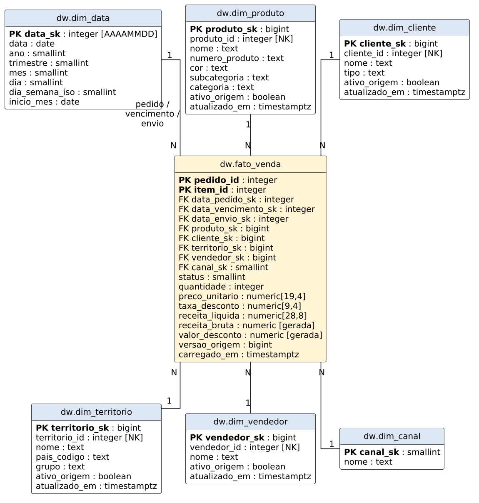
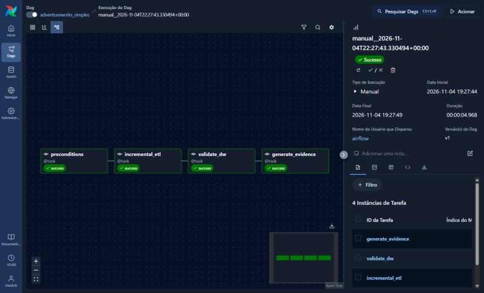

# Data Warehouse AdventureWorks com Apache Airflow

Data Warehouse em **PostgreSQL** no modelo **estrela (Star Schema)**, populado a partir do banco OLTP **AdventureWorks2016 (SQL Server)** por um ETL **incremental** orquestrado no **Apache Airflow 3**. O projeto calcula dez indicadores de vendas em SQL.

## Arquitetura

```
SQL Server (AdventureWorks2016, Change Tracking)
        │  extração consistente (snapshot) apenas das chaves alteradas
        ▼
ETL Python (etl/)  ── orquestrado pela DAG adventureworks_simples (Airflow)
        │  dimensões SCD1 → calendário → fato (upsert) → checkpoint, numa transação
        ▼
PostgreSQL (esquema dw: 1 fato + 6 dimensões; esquema etl: auditoria e checkpoint)
        │
        ▼
Views de indicadores (sql/kpis.sql)
```

## Estrutura do repositório

| Caminho | Conteúdo |
|---|---|
| `dags/adventureworks_dw.py` | DAG do Airflow (4 tarefas) |
| `etl/etl.py` | Carga, validação, indicadores e CLI |
| `etl/origem.py` | Leitura do SQL Server e do Change Tracking |
| `sql/origem.sql` | Habilita Change Tracking e snapshot na origem |
| `sql/dw.sql` | Criação do Data Warehouse (fato, dimensões, controle) |
| `sql/kpis.sql` | Dez indicadores em views SQL |
| `docs/modelo_estrela.puml` | Diagrama do modelo estrela (PlantUML) |
| `docs/dicionario_dados.md` | Dicionário de dados |
| `docs/img/` | Diagrama e capturas do Airflow |
| `EXECUCAO.md` | Passo a passo de execução |

## Modelo estrela

Grão da fato: **um item de pedido de venda**.



Dimensões: `dim_data` (papel múltiplo: pedido, vencimento, envio), `dim_produto` (com subcategoria e categoria desnormalizadas), `dim_cliente`, `dim_territorio`, `dim_vendedor` e `dim_canal`. Detalhes em [docs/dicionario_dados.md](docs/dicionario_dados.md).

## Carga incremental

1. `sql/origem.sql` habilita o **Change Tracking** nas dez tabelas de origem usadas.
2. A primeira execução carrega tudo e grava a versão da origem em `etl.controle`.
3. As execuções seguintes leem `CHANGETABLE(CHANGES ..., checkpoint)`, obtêm apenas as chaves alteradas, expandem para os pedidos e dimensões afetados e fazem upsert.
4. Dados, registro de sucesso e novo checkpoint são confirmados na **mesma transação**; uma falha não avança o checkpoint.
5. Itens excluídos na origem são removidos da fato; dimensões excluídas ficam com `ativo_origem = false`.

## DAG no Airflow

`preconditions → incremental_etl → validate_dw → generate_evidence`



## Indicadores

| Nº | Indicador | View |
|---|---|---|
| 1 | Receita bruta | `dw.kpi_01_receita_bruta` |
| 2 | Valor de descontos | `dw.kpi_02_descontos` |
| 3 | Receita líquida | `dw.kpi_03_receita_liquida` |
| 4 | Unidades vendidas | `dw.kpi_04_unidades` |
| 5 | Pedidos expedidos | `dw.kpi_05_pedidos` |
| 6 | Ticket médio | `dw.kpi_06_ticket_medio` |
| 7 | Taxa de desconto ponderada | `dw.kpi_07_taxa_desconto` |
| 8 | Clientes com compra | `dw.kpi_08_clientes_ativos` |
| 9 | Crescimento mensal da receita | `dw.kpi_09_crescimento_mensal` |
| 10 | Expedição no prazo | `dw.kpi_10_expedicao_no_prazo` |

## Como executar

Veja [EXECUCAO.md](EXECUCAO.md). Resumo:

```powershell
python baixar_backup.py
docker compose up -d --wait sqlserver postgres
docker compose run --rm etl restore
docker compose run --rm etl prepare-source
docker compose run --rm etl init
docker compose --profile airflow up -d --build airflow   # http://localhost:8081
```
