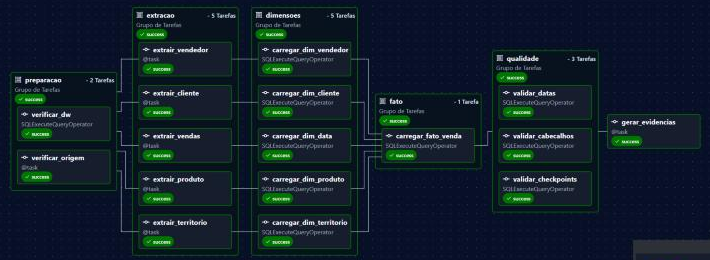

# Data Warehouse AdventureWorks com Apache Airflow

Data Warehouse em **PostgreSQL** no modelo **estrela (Star Schema)**, populado a partir do banco OLTP **AdventureWorks2016 (SQL Server)** por um ETL **incremental com área de stage**, orquestrado no **Apache Airflow 3** em blocos de tarefas paralelas. O projeto calcula dez indicadores de vendas em SQL.

## Arquitetura

```
SQL Server (produção: AdventureWorks2016 + Change Tracking)
   │  EXTRAÇÃO (Python): só chaves alteradas, snapshot, pool de 2 conexões
   ▼
PostgreSQL · esquema stage   (cópia dos registros alterados, formato da origem)
   │  CARGA (SQL puro): SCD1, chaves substitutas, membros inferidos, checkpoint
   ▼
PostgreSQL · esquema dw      (1 fato + 6 dimensões)  ──►  views de indicadores
             esquema etl     (checkpoint por grupo e auditoria de cada carga)
```

A origem só é lida no bloco de extração, com consultas curtas por chave primária em isolamento *snapshot* (não bloqueia quem grava). Todo o trabalho pesado roda depois, dentro do DW.

## Estrutura do repositório

| Caminho | Conteúdo |
|---|---|
| `dags/adventureworks_dw.py` | DAG do Airflow: 17 tarefas em 6 blocos |
| `etl/origem.py` | Consultas de extração por grupo (Change Tracking) |
| `etl/etl.py` | Extração para a stage, execução dos SQL, indicadores e CLI |
| `sql/origem.sql` | Habilita Change Tracking e snapshot na origem |
| `sql/stage.sql` | Criação da área de stage |
| `sql/dw.sql` | Criação do Data Warehouse e do controle (checkpoint e auditoria) |
| `sql/carga/*.sql` | Carga stage → DW: uma dimensão por arquivo e a fato |
| `sql/qualidade/*.sql` | Validações executadas após a carga |
| `sql/kpis.sql` | Dez indicadores em views SQL |
| `docs/modelo_estrela.puml` | Diagrama do modelo estrela (PlantUML) |
| `docs/dicionario_dados.md` | Dicionário de dados (DW e stage) |
| `docs/img/` | Diagrama e captura da DAG |
| `artigo/` | Artigo acadêmico (DOCX e PDF) |
| `EXECUCAO.md` | Passo a passo de execução |

## Modelo estrela

Grão da fato: **um item de pedido de venda**.


Dimensões: `dim_data` (papel múltiplo: pedido, vencimento, envio), `dim_produto` (com subcategoria e categoria desnormalizadas), `dim_cliente`, `dim_territorio`, `dim_vendedor` e `dim_canal`. Detalhes em [docs/dicionario_dados.md](docs/dicionario_dados.md).

## Carga incremental com stage

1. `sql/origem.sql` habilita o **Change Tracking** nas dez tabelas de origem usadas.
2. As tabelas são divididas em **cinco grupos** (produto, cliente, território, vendedor e vendas), cada um com seu próprio **checkpoint** em `etl.controle`.
3. **Extração**: cada grupo lê `CHANGETABLE(CHANGES ..., checkpoint)` e grava em `stage.*` só as linhas alteradas, com a operação (`I`, `U` ou `D`). Mudanças indiretas também entram: alterar uma pessoa atualiza o cliente e o vendedor dela. Sem checkpoint, o grupo faz carga completa.
4. **Carga**: um arquivo SQL por destino aplica a stage ao DW (upsert SCD Tipo 1, exclusões, chaves substitutas) e avança o checkpoint do grupo **na mesma transação**. Se falhar, nada é gravado e a próxima execução relê as mesmas mudanças.
5. **Membros inferidos**: se uma venda chega antes da sua dimensão (as extrações correm em paralelo), a carga da fato cria a linha da dimensão marcada como `inferido`, e a próxima carga da dimensão a completa.

## DAG no Airflow

Seis blocos (TaskGroups), com tarefas paralelas dentro de cada bloco:

`preparacao` (2) → `extracao` (5, pool `origem_sqlserver`) → `dimensoes` (5) → `fato` (1) → `qualidade` (3) → `gerar_evidencias`

Cada dimensão começa assim que a sua extração termina; a fato espera todas as dimensões.



## Indicadores

| Nº | Indicador | View |
|---|---|---|
| 1 | Receita bruta | `dw.kpi_01_receita_bruta` |
| 2 | Valor de descontos | `dw.kpi_02_descontos` |
| 3 | Receita líquida | `dw.kpi_03_receita_liquida` |
| 4 | Unidades vendidas | `dw.kpi_04_unidades` |
| 5 | Pedidos expedidos | `dw.kpi_05_pedidos` |
| 6 | Ticket médio | `dw.kpi_06_ticket_medio` |
| 7 | Taxa de desconto ponderada | `dw.kpi_07_taxa_desconto` |
| 8 | Clientes com compra | `dw.kpi_08_clientes_ativos` |
| 9 | Crescimento mensal da receita | `dw.kpi_09_crescimento_mensal` |
| 10 | Expedição no prazo | `dw.kpi_10_expedicao_no_prazo` |

## Como executar

Veja [EXECUCAO.md](EXECUCAO.md). Resumo:

```powershell
python baixar_backup.py
docker compose up -d --wait sqlserver postgres
docker compose run --rm etl restore
docker compose run --rm etl prepare-source
docker compose run --rm etl init
docker compose run --rm etl run                          # carga inicial
docker compose --profile airflow up -d --build airflow   # http://localhost:8081
```
