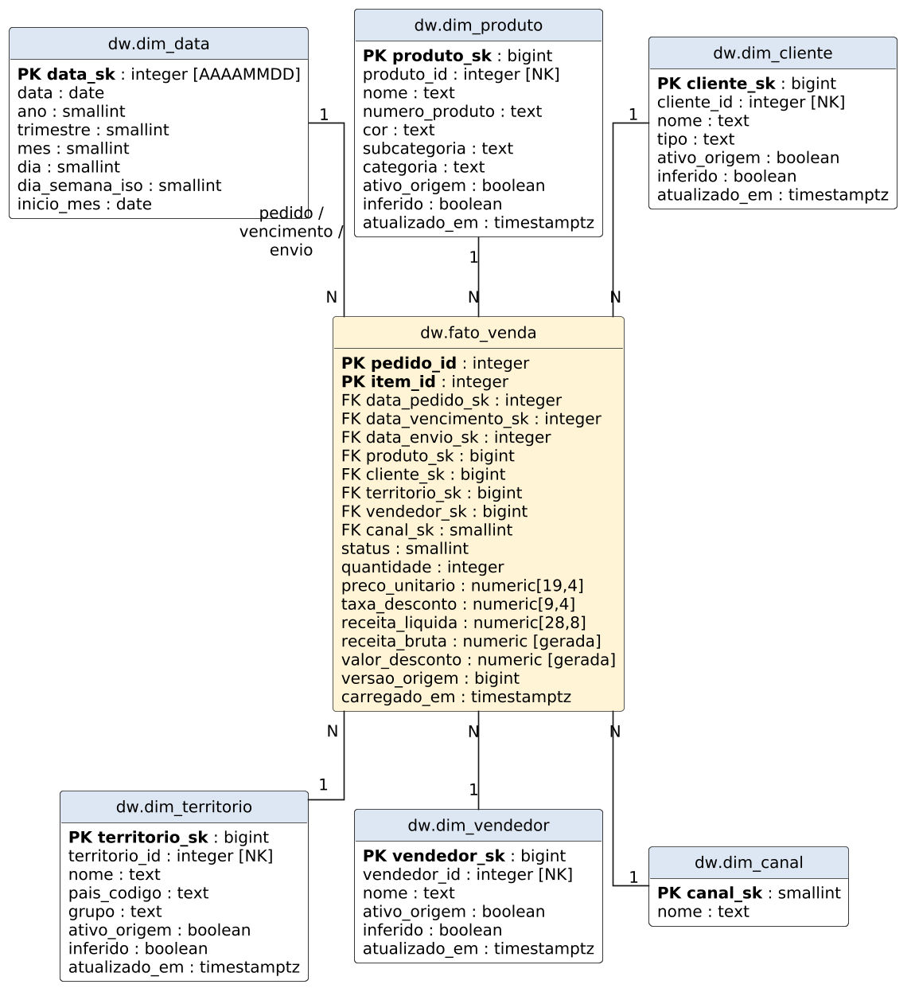

# Dicionário de dados — esquema `dw`

Modelo estrela com uma tabela fato (`fato_venda`) e seis dimensões. Todas as dimensões usam SCD Tipo 1 (sobrescrita), chave substituta (`*_sk`) e chave natural da origem (`*_id`). Produto, cliente, território e vendedor têm ainda `ativo_origem` (falso quando o registro foi excluído na origem) e `inferido` (verdadeiro quando a linha foi criada pela carga da fato antes de a dimensão chegar; a próxima carga da dimensão a completa).

## dw.fato_venda

Grão: **um item de pedido de venda** (`Sales.SalesOrderDetail`). Chave primária: `(pedido_id, item_id)`.

| Coluna | Tipo | Descrição | Origem |
|---|---|---|---|
| pedido_id | integer | Número do pedido (dimensão degenerada) | SalesOrderHeader.SalesOrderID |
| item_id | integer | Número do item no pedido | SalesOrderDetail.SalesOrderDetailID |
| data_pedido_sk | integer | FK para `dim_data` — data do pedido | SalesOrderHeader.OrderDate |
| data_vencimento_sk | integer | FK para `dim_data` — data de vencimento | SalesOrderHeader.DueDate |
| data_envio_sk | integer (nulo) | FK para `dim_data` — data de envio | SalesOrderHeader.ShipDate |
| produto_sk | bigint | FK para `dim_produto` | SalesOrderDetail.ProductID |
| cliente_sk | bigint | FK para `dim_cliente` | SalesOrderHeader.CustomerID |
| territorio_sk | bigint | FK para `dim_territorio` (0 = não informado) | SalesOrderHeader.TerritoryID |
| vendedor_sk | bigint | FK para `dim_vendedor` (0 = sem vendedor) | SalesOrderHeader.SalesPersonID |
| canal_sk | smallint | FK para `dim_canal` (0 revendedor, 1 online) | SalesOrderHeader.OnlineOrderFlag |
| status | smallint | Situação do pedido (1 a 6; 5 = expedido) | SalesOrderHeader.Status |
| quantidade | integer | Unidades vendidas no item | SalesOrderDetail.OrderQty |
| preco_unitario | numeric(19,4) | Preço unitário de venda | SalesOrderDetail.UnitPrice |
| taxa_desconto | numeric(9,4) | Desconto unitário (0 a 1) | SalesOrderDetail.UnitPriceDiscount |
| receita_liquida | numeric(28,8) | Receita após desconto | SalesOrderDetail.LineTotal |
| receita_bruta | numeric (gerada) | `quantidade * preco_unitario` | calculada |
| valor_desconto | numeric (gerada) | `receita_bruta - receita_liquida` | calculada |
| versao_origem | bigint | Versão do Change Tracking que gravou a linha | ETL |
| carregado_em | timestamptz | Data/hora da última gravação | ETL |

## dw.dim_data

Dimensão de papel múltiplo (pedido, vencimento e envio). Gerada pelo ETL para todo o intervalo de datas da fato.

| Coluna | Tipo | Descrição |
|---|---|---|
| data_sk | integer | Chave no formato AAAAMMDD |
| data | date | Data do calendário |
| ano, trimestre, mes, dia | smallint | Partes da data |
| dia_semana_iso | smallint | 1 = segunda … 7 = domingo |
| inicio_mes | date | Primeiro dia do mês (agrupamento mensal) |

## dw.dim_produto

| Coluna | Tipo | Descrição | Origem |
|---|---|---|---|
| produto_sk | bigint | Chave substituta | identidade |
| produto_id | integer | Chave natural | Product.ProductID |
| nome | text | Nome do produto | Product.Name |
| numero_produto | text | Código comercial | Product.ProductNumber |
| cor | text (nulo) | Cor | Product.Color |
| subcategoria | text | Subcategoria (desnormalizada) | ProductSubcategory.Name |
| categoria | text | Categoria (desnormalizada) | ProductCategory.Name |
| ativo_origem | boolean | Falso se o registro foi excluído na origem | ETL |
| inferido | boolean | Membro inferido, ainda sem os atributos da origem | ETL |
| atualizado_em | timestamptz | Última atualização | ETL |

## dw.dim_cliente

| Coluna | Tipo | Descrição | Origem |
|---|---|---|---|
| cliente_sk | bigint | Chave substituta | identidade |
| cliente_id | integer | Chave natural | Customer.CustomerID |
| nome | text | Nome da loja ou da pessoa | Store.Name / Person.* |
| tipo | text | `Loja`, `Pessoa` ou `Não informado` | Customer.StoreID / PersonID |
| ativo_origem, inferido, atualizado_em | — | Controle do ETL | ETL |

## dw.dim_territorio

| Coluna | Tipo | Descrição | Origem |
|---|---|---|---|
| territorio_sk | bigint | Chave substituta (0 = não informado) | identidade |
| territorio_id | integer | Chave natural | SalesTerritory.TerritoryID |
| nome | text | Nome do território | SalesTerritory.Name |
| pais_codigo | text | Código do país | SalesTerritory.CountryRegionCode |
| grupo | text | Grupo geográfico | SalesTerritory.Group |
| ativo_origem, inferido, atualizado_em | — | Controle do ETL | ETL |

## dw.dim_vendedor

| Coluna | Tipo | Descrição | Origem |
|---|---|---|---|
| vendedor_sk | bigint | Chave substituta (0 = sem vendedor, vendas online) | identidade |
| vendedor_id | integer | Chave natural | SalesPerson.BusinessEntityID |
| nome | text | Nome completo | Person.FirstName/MiddleName/LastName |
| ativo_origem, inferido, atualizado_em | — | Controle do ETL | ETL |

## dw.dim_canal

| Coluna | Tipo | Descrição |
|---|---|---|
| canal_sk | smallint | 0 = Revendedor, 1 = Online |
| nome | text | Nome do canal |

## Esquema `stage` (área de preparação)

Recebe da origem só os registros alterados, com os nomes de colunas do OLTP. Cada tabela é substituída a cada extração do seu grupo. `operacao`: `I` inserido, `U` alterado ou afetado por tabela relacionada, `D` excluído.

| Tabela | Grupo | Origem | Colunas |
|---|---|---|---|
| stage.produto | produto | Product + ProductSubcategory + ProductCategory | operacao, product_id, name, product_number, color, subcategoria, categoria |
| stage.cliente | cliente | Customer + Person + Store | operacao, customer_id, person_id, store_id, first_name, middle_name, last_name, store_name |
| stage.territorio | territorio | SalesTerritory | operacao, territory_id, name, country_region_code, grupo |
| stage.vendedor | vendedor | SalesPerson + Person | operacao, business_entity_id, first_name, middle_name, last_name |
| stage.pedido | vendas | SalesOrderHeader | operacao, sales_order_id, order_date, due_date, ship_date, customer_id, territory_id, sales_person_id, online_order_flag, status |
| stage.item | vendas | SalesOrderDetail | operacao, sales_order_id, sales_order_detail_id, product_id, order_qty, unit_price, unit_price_discount, line_total |
| stage.lote | — | — | grupo, execucao_id, versao_de (nulo = carga completa), versao_ate, identidade_origem, linhas, extraido_em |

## Esquema `etl` (controle da carga incremental)

| Tabela | Finalidade |
|---|---|
| etl.controle | Checkpoint por grupo: última versão do Change Tracking aplicada ao DW, identidade da origem e execução |
| etl.carga | Auditoria: por execução e grupo, modo (completa ou incremental), faixa de versões, linhas na stage e linhas gravadas |
